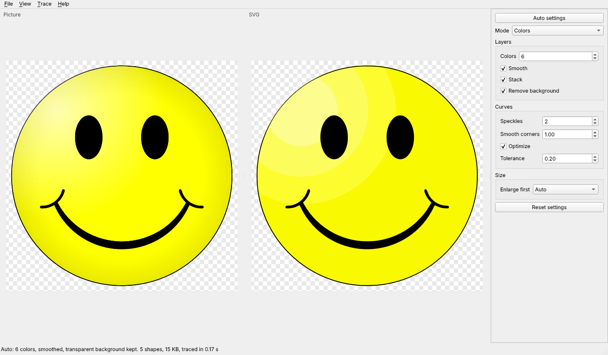

# KanzonasSVG

Turn pictures (logos, drawings, scans) into SVG files, on Windows and Linux.



KanzonasSVG does one thing: it traces a picture into an SVG. Open a picture and it picks the
settings that suit it (how many colors, smoothing, background) and shows the SVG beside it;
change any setting if you like, then save it. Edit the SVG afterwards in
Inkscape, Illustrator or any vector editor.

The tracing is Inkscape's *Trace Bitmap* (Potrace and Autotrace), taken out of Inkscape and
fixed:

- **Exact colors.** A logo's colors come out exactly as in the picture, not a step or two off.
- **Sharp edges.** No rings of in-between shades around shapes and letters, and no blurred
  edges from smoothing.
- **Holes stay holes.** With Autotrace, the inside of an O is no longer filled in, and big
  areas no longer cover everything else.
- **Faster** on big pictures (a 12-megapixel picture with 8 colors: 6.4 s with Inkscape's
  code before these fixes, 1.8 s here).
- **Small pictures traced at twice the size** (Enlarge first: Auto), for smoother curves.

## Download

From [Releases](https://github.com/keithlyding/KanzonasSVG/releases):

- **Windows:** `KanzonasSVG-windows.zip`. Unzip it anywhere and run `KanzonasSVG.exe`.
- **Linux (64-bit; Ubuntu 22.04, Debian 12, Fedora 36 or newer):** `KanzonasSVG-x86_64.AppImage`.
  Make it executable (`chmod +x KanzonasSVG-x86_64.AppImage`) and run it.

## Using it

1. Open a picture: *File > Open picture* (Ctrl+O), drag it into the window, or copy a picture
   and *File > Paste picture* (Ctrl+V).
2. KanzonasSVG picks the settings for the picture (**Auto settings**: exactly a logo's colors,
   smoothing for JPEGs and scans, a transparent background kept transparent, black and white
   for a scan of dark lines) and the status bar says what it picked. Change any setting on the
   right and the SVG updates.
3. *File > Save SVG* (Ctrl+S), or *File > Copy SVG* (Ctrl+Shift+C) to paste it into Inkscape or
   another program.

Modes: **Colors** (best for logos: count the background as a color), Grays, Brightness steps,
Black and white, Edges, Autotrace colors, and Autotrace centerline (lines along the middle of
strokes). *Help > How to use KanzonasSVG* (F1) explains every setting.

### Command line

The same tracing, for one picture or many (on Windows, `kanzonassvg-cli.exe` in the program's
folder; on Linux, the AppImage with options):

```
kanzonassvg-cli logo.png                      logo.svg next to it, settings picked for it
kanzonassvg-cli --colors 4 *.png -o svgs      every PNG into the svgs folder, 4 colors each
kanzonassvg-cli --no-auto logo.png            the defaults (8 colors) instead of picked settings
kanzonassvg-cli --mode bw scan.jpg -o scan.svg
kanzonassvg-cli --help                        every option
```

## How much better

Badly wrong pixels (off by over 25% when the SVG is drawn and compared with the picture),
Inkscape's code before these fixes against KanzonasSVG:

| Picture | Mode | Before | KanzonasSVG |
|---|---|---|---|
| [Smiley](https://commons.wikimedia.org/wiki/File:Smiley.svg) (public domain) | Colors, 8 | 0.47% | 0.27% |
| Smiley | Autotrace colors, 8 | 65% | 0.61% |
| [The Starry Night](https://commons.wikimedia.org/wiki/File:Van_Gogh_-_Starry_Night_-_Google_Art_Project.jpg) (public domain) | Colors, 16 | 3.0% | 2.3% |
| The Starry Night | Autotrace colors, 16 | 30% | 12.7% |
| A two-color logo | Colors, 8 | 0.89% | 0.17% |

Costs: keeping strong edges sharp adds about 15% more nodes on detailed pictures (paintings,
screenshots), and Autotrace takes longer on big pictures because the colors are reduced
first (it makes far fewer shapes).

The same fixes were offered to Inkscape:
[inkscape!8302](https://gitlab.com/inkscape/inkscape/-/merge_requests/8302).

## Building from source

Needs Python 3.10 or newer, CMake 3.16 or newer and a C/C++ compiler (Visual Studio 2022 on
Windows; gcc or clang on Linux).

```
python -m pip install -r requirements.txt -c constraints.txt
python tools/build_engine.py        # the tracing engine, into kanzonassvg/lib
python run.py                       # the window (or: python run.py --help)
QT_QPA_PLATFORM=offscreen python -m unittest discover -s tests -p "test_*.py" -t .
```

`.github/workflows/build.yml` builds the Windows zip and the Linux AppImage, and runs the tests
and a self test inside each (`KanzonasSVG --selftest selftest.log`).

## License

Free software under the GNU General Public License, version 2 or later (LICENSE). It's built
on code from Inkscape, Potrace (Peter Selinger) and Autotrace (Martin Weber and others), and
Qt for Python: see NOTICE.md.
