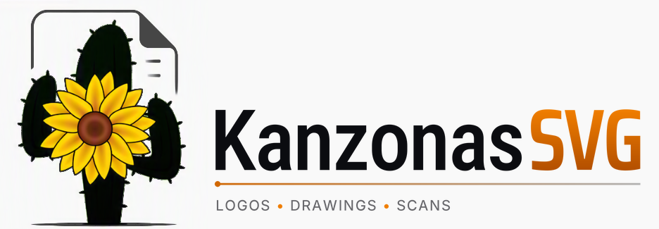
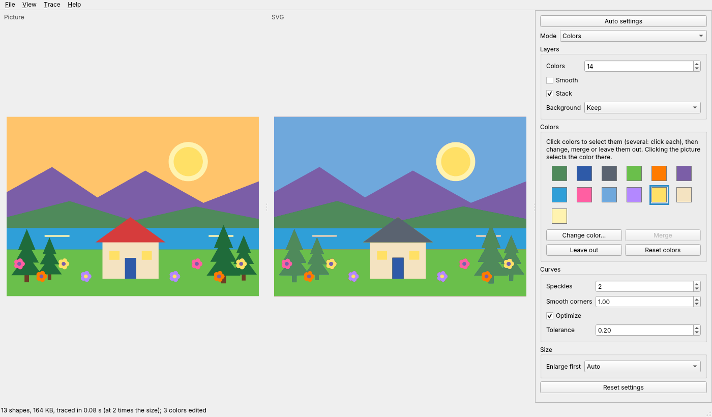

# KanzonasSVG



Turn pictures (logos, drawings, scans) into SVG files, on Windows and Linux.


KanzonasSVG does one thing: it traces a picture into an SVG. Open a picture and it picks the
settings that suit it (how many colors, smoothing, background) and shows the SVG beside it;
change any setting if you like, then save it. Edit the SVG afterwards in
Inkscape, Illustrator or any vector editor.

The tracing is Inkscape's *Trace Bitmap* (Potrace and Autotrace), taken out of Inkscape and
fixed:

- **Exact colors.** A logo's colors come out exactly as in the picture, not a step or two off.
- **Sharp edges.** No rings of in-between shades around shapes and letters, and no blurred
  edges from smoothing.
- **Holes stay holes.** With Autotrace, the inside of an O is no longer filled in, and big
  areas no longer cover everything else.
- **Faster** on big pictures (a 12-megapixel picture with 8 colors: 6.4 s with Inkscape's
  code before these fixes, 1.8 s here).
- **Small pictures traced at twice the size** (Enlarge first: Auto), for smoother curves.

## Download

From [Releases](https://github.com/keithlyding/KanzonasSVG/releases):

- **Windows:** `KanzonasSVG-v<version>-setup.exe`. Run it (no administrator rights needed); it
  adds KanzonasSVG to the Start menu and to "Open with" for pictures, and a newer one installed
  over it updates it. Or, without installing: `KanzonasSVG-windows.zip`; unzip it anywhere and
  run `KanzonasSVG.exe`.
- **Linux (64-bit; Ubuntu 22.04, Debian 12, Fedora 36 or newer):** `KanzonasSVG-x86_64.AppImage`.
  Make it executable (`chmod +x KanzonasSVG-x86_64.AppImage`) and run it.

**Updates** (from 1.1 on): once a day KanzonasSVG asks GitHub whether a newer version is out
(*Help > Check for updates automatically*; nothing about you or your pictures is sent) and says so
in the status bar, with what's new since your version. **Update now** downloads it, checks it
against the checksum GitHub publishes with the release, and puts it in place: the setup runs
over an installed copy, an unzipped copy gets the new files in its folder, and the AppImage
replaces itself; then KanzonasSVG starts again, settings kept. Nothing is downloaded or
installed until you click it. (1.0.x doesn't have this: install 1.1 by hand once.)

## Using it

1. Open a picture: *File > Open picture* (Ctrl+O), drag it into the window, or copy a picture
   and *File > Paste picture* (Ctrl+V).
2. KanzonasSVG picks the settings for the picture (**Auto settings**: exactly a logo's or a flat illustration's colors, up to 64,
   smoothing for JPEGs and scans, a transparent background kept transparent, black and white
   for a scan of dark lines, and for a drawing or plan of thin lines, its lines' colors and
   enlarging 4 times; every setting, the curve settings too) and the status bar says what it picked. Change any setting on the
   right and the SVG updates.
3. To change the colors it's traced with, use the **Colors** box: select colors (or click the
   picture), then **Change color...**, **Merge** (several shades into one, for a simpler SVG) or
   **Leave out** (see-through). The picture itself stays as it is.
4. To trace only part of the picture (a drawing in a screenshot, without the toolbars around
   it), *Trace > Crop picture* (Ctrl+R) and drag across that part.
5. *File > Save SVG* (Ctrl+S), or *File > Copy SVG* (Ctrl+Shift+C) to paste it into Inkscape or
   another program.

**Background**: *Remove* makes the picture's background (the color around its edge, light or
dark) see-through and keeps that color inside shapes; *Remove, also inside* removes that color
everywhere.




Modes: **Colors** (best for logos: count the background as a color), Grays, Brightness steps,
Black and white, Edges, Autotrace colors, and Autotrace centerline (lines along the middle of
strokes). *Help > How to use KanzonasSVG* (F1) explains every setting.

### Command line

The same tracing, for one picture or many (on Windows, `kanzonassvg-cli.exe` in the program's
folder; on Linux, the AppImage with options):

```
kanzonassvg-cli logo.png                      logo.svg next to it, settings picked for it
kanzonassvg-cli --colors 4 *.png -o svgs      every PNG into the svgs folder, 4 colors each
kanzonassvg-cli --no-auto logo.png            the defaults (8 colors) instead of picked settings
kanzonassvg-cli --background remove logo.jpg  a see-through background
kanzonassvg-cli --mode bw scan.jpg -o scan.svg
kanzonassvg-cli --help                        every option
```

## Compared with Inkscape

KanzonasSVG's tracing is Inkscape's *Trace Bitmap* with fixes. Measured against Inkscape's own
code (its development version of 10 November 2026, whose tracing is the same as Inkscape
1.4.4's, the newest release), on the same pictures, with the same settings (Inkscape's
defaults) and with KanzonasSVG's Auto settings. Every SVG was drawn by the same renderer
(rsvg-convert) and compared with the picture on white.

**Pixels clearly the wrong color** (off by over 25%; lower is better):

| Picture | Inkscape, 8 colors | KanzonasSVG, 8 colors | KanzonasSVG, Auto | Inkscape, Autotrace | KanzonasSVG, Autotrace |
|---|---|---|---|---|---|
| A two-color logo | 1.6% | 0.27% | 0.26% | 3.9% | 0.52% |
| The same logo as a JPEG | 1.5% | 0.34% | 0.34% | 4.2% | 2.3% |
| Sunflower and cactus (transparent) | 6.5% | 1.9% | 2.5% | 8.0% | 4.3% |
| [Smiley](https://commons.wikimedia.org/wiki/File:Smiley.svg) (public domain) | 0.46% | 0.27% | 0.23% | 65% (a black disc) | 0.60% |
| A flat illustration, 15 colors | 1.7% | 0.79% | 0.29% | 3.9% | 0.91% |
| A floor plan (thin gray lines, blue labels) | 0.87% | 0.07% | 0.002% | | |
| [The Starry Night](https://commons.wikimedia.org/wiki/File:Van_Gogh_-_Starry_Night_-_Google_Art_Project.jpg) (public domain) | 3.7% | 3.2% | 2.9% | 23% | 8.8% |

**Time and file size**, Inkscape with 8 colors and KanzonasSVG with Auto settings (picking the
settings included). On a 4-core computer; KanzonasSVG uses all its cores, and traces pictures
under 1000 pixels at twice their size (Enlarge first: Auto), the floor plan at four times:

| Picture | Inkscape | KanzonasSVG |
|---|---|---|
| A two-color logo | 0.08 s, 160 KB | 0.06 s, 24 KB |
| The same logo as a JPEG | 0.10 s, 164 KB | 0.03 s, 25 KB |
| Sunflower and cactus | 0.02 s, 152 KB | 0.02 s, 160 KB |
| Smiley | 0.20 s, 39 KB | 0.06 s, 15 KB |
| A flat illustration, 15 colors | 0.07 s, 100 KB | 0.13 s, 182 KB (all 14 colors kept; Inkscape's 8 lose some) |
| A floor plan | 0.08 s, 176 KB | 0.41 s, 185 KB |
| The Starry Night (1280 x 1014) | 1.1 s, 6.3 MB | 0.24 s, 4.1 MB |

What each does:

| | Inkscape's Trace Bitmap | KanzonasSVG |
|---|---|---|
| Picks the settings for each picture | No | Auto settings: colors, smoothing, background, line art |
| Colors | Close to the picture's | Exactly the picture's, for flat colors |
| Edges between colors | In-between shades as extra outlines | Sharp |
| Thin lines (plans, drawings, screenshots) | Thickened and faded by smoothing | Kept, in their colors |
| Autotrace | Big areas cover the rest (the smiley: a black disc), holes filled in | Fixed |
| Leaving the background out | Remove background (the bottom layer) | The color around the edge, around the picture or everywhere, or the transparent part |
| Tracing part of a picture | | Crop |
| The result while you set it up | A small preview | The SVG beside the picture, zooming together |
| Many files at once | | The command line |
| Editing the SVG afterwards | Yes: it's a vector editor | No: open the SVG in Inkscape, Illustrator or another editor |
| Pixel art (Depixelize), selecting the foreground (SIOX) | Yes | No |
| Systems | Windows, macOS, Linux | Windows, Linux |

Costs: keeping strong edges sharp adds about 15% more nodes on detailed pictures (paintings,
screenshots), Autotrace takes longer on big pictures because the colors are reduced first (it
makes far fewer shapes), and line art is traced at four times its size (slower, and a bigger
file, for lines that stay solid).

The same fixes were offered to Inkscape:
[inkscape!8302](https://gitlab.com/inkscape/inkscape/-/merge_requests/8302).

## Building from source

Needs Python 3.10 or newer, CMake 3.16 or newer and a C/C++ compiler (Visual Studio 2022 on
Windows; gcc or clang on Linux).

```
python -m pip install -r requirements.txt -c constraints.txt
python tools/build_engine.py        # the tracing engine, into kanzonassvg/lib
python run.py                       # the window (or: python run.py --help)
QT_QPA_PLATFORM=offscreen python -m unittest discover -s tests -p "test_*.py" -t .
```

`.github/workflows/build.yml` builds the Windows installer and zip and the Linux AppImage, and
runs the tests and a self test inside each (`KanzonasSVG --selftest selftest.log`).

Batteries that try to break it: `tests/engine_battery.sh` (random pictures and settings through
the engine, with AddressSanitizer and UBSan), `tests/fuzz_engine.sh` (libFuzzer) and
`tests/battery_app.py` (odd and broken picture files, and thousands of random actions in the
window). Short runs of the first and last are in every build.

## License

Free software under the GNU General Public License, version 2 or later (LICENSE). It's built
on code from Inkscape, Potrace (Peter Selinger) and Autotrace (Martin Weber and others), and
Qt for Python: see NOTICE.md.
